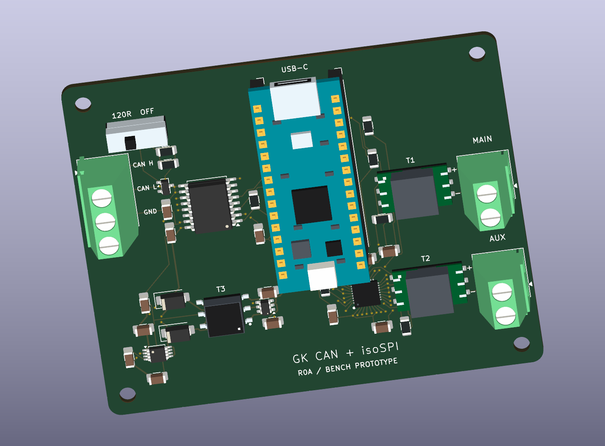

# GK CAN + isoSPI Adapter

An **85 × 70 mm, four-layer USB adapter** for Classical CAN and two isolated isoSPI links. A socketed Arduino Nano R4 handles USB communication and programming through its onboard USB-C port.

> **R0A bench prototype.** KiCad 10.0.6 reports zero ERC, DRC, unconnected-item and schematic-parity findings. Hardware bring-up, signal integrity and system insulation qualification are pending.

| Interface | Hardware |
|---|---|
| Controller | Arduino Nano R4 with headers (ABX00143), installed in J1/J2 |
| CAN | ISO1042DWR, up to 1 Mbit/s, isolated regulated supply, TVS and switchable 120 Ω |
| isoSPI | ADBMS6822 with MAIN and AUX on separate floating twisted pairs |
| isoSPI magnetics | Two Bourns SM91801AL-E transformers, each specified for 1,000 V DC working voltage and basic insulation |
| Fabrication | 1.6 mm board, four copper layers, rounded corners and predominantly 1206 passives |

## Connections

Orient the board with USB-C at the top. The left terminal is marked **CAN H**, **CAN L**, and **GND** from top to bottom. This GND is the isolated CAN reference. Set the slide switch to **120R** when the adapter terminates an end of the CAN bus.

The two right terminals are **MAIN** and **AUX**. Each uses a floating differential pair with **+** above **−**. MAIN and AUX share the Nano's SPI bus and have individual chip selects.

| Nano pins | Function |
|---|---|
| D4 / D5 | CAN TX / RX |
| D8 / A3 | CAN supply enable, active high / fault, active low |
| D13 / D11 / D12 | SPI clock / controller out / controller in |
| D10 / D9 | MAIN / AUX chip select |
| D2 / D3 | MAIN / AUX interrupt status |
| D6 / D7 | MAIN / AUX wake status |

The first bench target is ADBMS1818 at up to 1 Mbit/s. ADBMS6832 operation at 2 Mbit/s is a validation target with the actual cable and slave-board network. D8 defaults low, so firmware must enable the CAN converter after establishing the allowed USB power state. The user supplies the firmware.

## Design files

- [KiCad project](hardware/kicad/GK_CAN_isoSPI_adapter.kicad_pro), [schematic](hardware/kicad/GK_CAN_isoSPI_adapter.kicad_sch) and [routed PCB](hardware/kicad/GK_CAN_isoSPI_adapter.kicad_pcb)
- [3D model sources and coverage](hardware/kicad/models/README.md)
- [R0A fabrication and assembly review files](manufacturing/prototype/R0A/README.md)
- [Design rationale](docs/hardware-plan.md), [references](docs/references.md) and [bench verification plan](tests/verification-plan.md)

## Prototype limits

The PCB uses an **8 mm copper clearance rule** for each isoSPI cable domain. The 1 kV DC figure is the transformer working rating. Board creepage, insulation coordination, cable and enclosure clearances still need validation. The CAN converter serves a separate low-voltage CAN network.

The earlier JLCPCB check found one SM91801AL-E (C26423704) in stock. Each board needs two. Review current stock, transformer procurement, socket fit and assembly rotations before placing an order. See the [component shortlist](docs/components.md) and [third-party materials](THIRD_PARTY.md).
