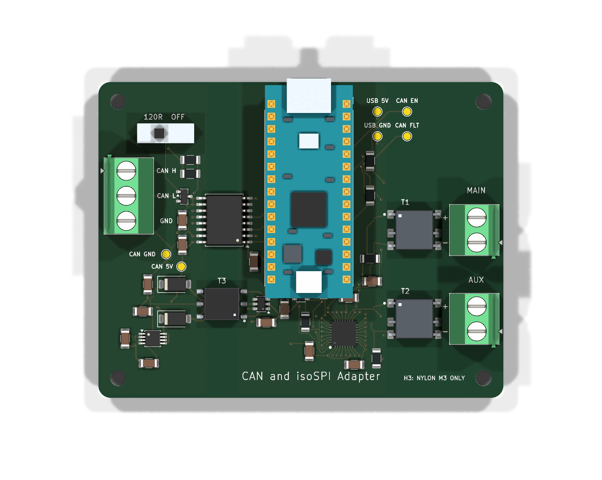
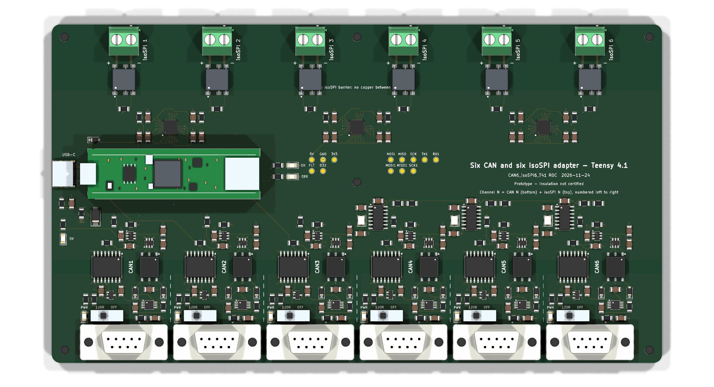

# CAN and isoSPI Adapters

Two USB adapters for battery-management bench work. Both connect a host PC to isolated Classical CAN and isoSPI, with socketed controller modules and switchable CAN termination.

| | [Nano R4 · R0E](#nano-r4-adapter-r0e) | [Teensy 4.1 · T41-R0C](#teensy-41-adapter-t41-r0c) |
|---|:---:|:---:|
| Top view |  |  |
| Controller | Arduino Nano R4 (socketed) | Teensy 4.1 (socketed) |
| USB | Nano's own USB-C | Carrier USB-C for power and data |
| CAN ports | 1, screw terminal | 6, vertical DSUB-9 female (CiA 303-1 pinout) |
| CAN isolation | ISO1042 with isolated 5 V supply | Six independent ISO1042 channels, each with its own isolated 5 V supply |
| CAN termination | 120 Ω slide switch | 120 Ω slide switch on every port |
| isoSPI ports | 2 (MAIN, AUX) | 6 |
| Board | 82 × 64 mm, 4 layers | 216 × 120 mm, 6 layers |
| Prototype files | [Nano Gerbers, BOM and CPL](manufacturing/prototype/R0E/) | [Teensy Gerbers, BOM and CPL](manufacturing/prototype/T41-R0C/) |

> **Prototype status.** Both boards pass their recorded KiCad ERC, DRC and schematic-parity checks. Every JLCPCB part on both BOMs was in stock on 2026-11-24. Hardware bring-up and insulation qualification are pending. The 1,000 V DC pack and 3 m isoSPI cable targets remain unqualified. The manufacturing files are for prototype review. See the [bench verification plan](tests/verification-plan.md).

## Nano R4 adapter (R0E)

| Interface | Hardware |
|---|---|
| Controller | Arduino Nano R4 with headers (ABX00143), installed in J1/J2 |
| CAN | ISO1042DWR, up to 1 Mbit/s, isolated regulated supply, TVS and switchable 120 Ω |
| isoSPI | ADBMS6822 with MAIN and AUX on separate floating twisted pairs |
| isoSPI magnetics | Two CND-tek HM1238NLTP transformers, each specified for 1,000 V DC working voltage and basic insulation |

Orient the board with USB-C at the top. The left terminal is marked **CAN H**, **CAN L** and **GND** from top to bottom. This GND is the isolated CAN reference. Set the slide switch to **120R** when the adapter terminates an end of the bus. The two right terminals are **MAIN** and **AUX**, each a floating differential pair with **+** above **−**.

| Nano pins | Function |
|---|---|
| D4 / D5 | CAN TX / RX |
| D8 / A3 | CAN supply enable, active high / fault, active low |
| D13 / D11 / D12 | SPI clock / controller out / controller in |
| D10 / D9 | MAIN / AUX chip select |
| D2 / D3 | MAIN / AUX interrupt status |
| D6 / D7 | MAIN / AUX wake status |

R0E replaces three parts that JLCPCB no longer stocked: the isoSPI transformers (now HM1238NLTP), the CAN supply transformer (now MXPP6-3K6110) and the CAN LDO (now TPS7A1650-Q1). See the [R0E notes](docs/r0e.md). Mounting hole H3 is close to the AUX terminal and must take **nylon hardware only**; the silkscreen says so ([R0D notes](docs/r0d.md)).

- [KiCad project](hardware/kicad/CAN_isoSPI_adapter.kicad_pro), [schematic](hardware/kicad/CAN_isoSPI_adapter.kicad_sch) and [routed PCB](hardware/kicad/CAN_isoSPI_adapter.kicad_pcb)
- [Nano R4 firmware](firmware/README.md#nano-r4-adapter)
- [R0E fabrication files](manufacturing/prototype/R0E/README.md) and [checks](tests/R0E/)

## Teensy 4.1 adapter (T41-R0C)

Six isolated CAN ports on DSUB-9 connectors along one long edge and six isoSPI terminals along the opposite long edge. **Channel N** is one column: CAN N sits directly opposite isoSPI N, numbered 1–6 from left to right, and the same number is used on the silkscreen, in the schematic, in reference designators and in the firmware. Each adapter reports a unique ID and an optional stored label, so several can share one host. A single USB-C connector supplies power and USB data; the data lines reach the Teensy through two pogo pins that touch its USB device pads. **Keep the Teensy's VIN–VUSB pads joined** and never plug its own micro-USB.

> **Before powered bring-up:** Resolve the six direct ADBMS6822 INTR connections to the Teensy’s 3.3 V inputs.

R0C replaces the same three out-of-stock parts as the Nano R0E ([T41-R0C notes](docs/t41-r0c.md)). R0B fixed the USB path of R0A: the Teensy VUSB pin is powered again, the D+/D− lines lost their 90 mm test-pad stubs, and VBUS runs on a 1 mm outer-layer track ([T41-R0B notes](docs/t41-r0b.md)).

| Interface | Hardware |
|---|---|
| Controller | Teensy 4.1 with pins, in two 1 × 24 sockets |
| CAN1–CAN3 | Teensy FlexCAN1–3 (CAN3 is CAN FD capable) |
| CAN4–CAN6 | MCP2518FD controllers on SPI1, 40 MHz crystals |
| Each CAN port | ISO1042DWR, TPS2553 current-limited switch, SN6505B + MXPP6-3K6110 isolated supply, TPS7A1650-Q1 LDO, PESD2CANFD24V TVS, 120 Ω switch, power LED |
| CAN connector | DSUB-9 female: pin 2 CAN_L, pin 7 CAN_H, pins 3 and 6 CAN_GND, pin 5 and shell to a 1 MΩ ∥ 4.7 nF shield network |
| isoSPI | Three ADBMS6822, six HM1238NLTP transformers, six two-pole terminals |
| USB-C | 5.1 kΩ CC pull-downs read by the Teensy for power budgeting, USBLC6 ESD, 2 A PTC, SMAJ5.0A |

- [User manual](docs/user-manual-t41.md) — assembly, flashing, commands and usage examples
- [Hardware notes and pin map](hardware/teensy41/README.md)
- [KiCad project](hardware/teensy41/CAN6_isoSPI6_T41.kicad_pro), generated from [design.py](hardware/teensy41/tools/design.py)
- [Teensy firmware](firmware/README.md#teensy-41-adapter)
- [R0C fabrication files for JLCPCB](manufacturing/prototype/T41-R0C/README.md) and [checks](tests/T41-R0C/)

## Shared documentation

- [Design rationale](docs/hardware-plan.md), [decisions](docs/decisions.md), [component sourcing](docs/components.md) and [references](docs/references.md)
- [Bench verification plan](tests/verification-plan.md)
- [3D model sources](hardware/kicad/models/README.md) and [third-party materials](THIRD_PARTY.md)

## Prototype limits

The PCB rules require **8 mm copper clearance** around each floating isoSPI cable domain. The **1 kV DC** transformer working rating applies to the HM1238NLTP, which provides basic insulation. Protective insulation still needs to be established for the complete system, including PCB creepage, mounting, cables and enclosure. The CAN ports are intended for low-voltage CAN networks.

On 2026-11-24 JLCPCB stocked every part. The scarcest parts limit an order to about 23 Teensy boards or 139 Nano boards ([stock list](docs/components.md#stock-check-2026-11-24)). Recheck stock, placement rotations, through-hole assembly and socket fit before ordering. See the [design decisions](docs/decisions.md) and [manufacturing workflow](manufacturing/README.md).

No license has been selected yet; see [publication notes](docs/publication.md).
