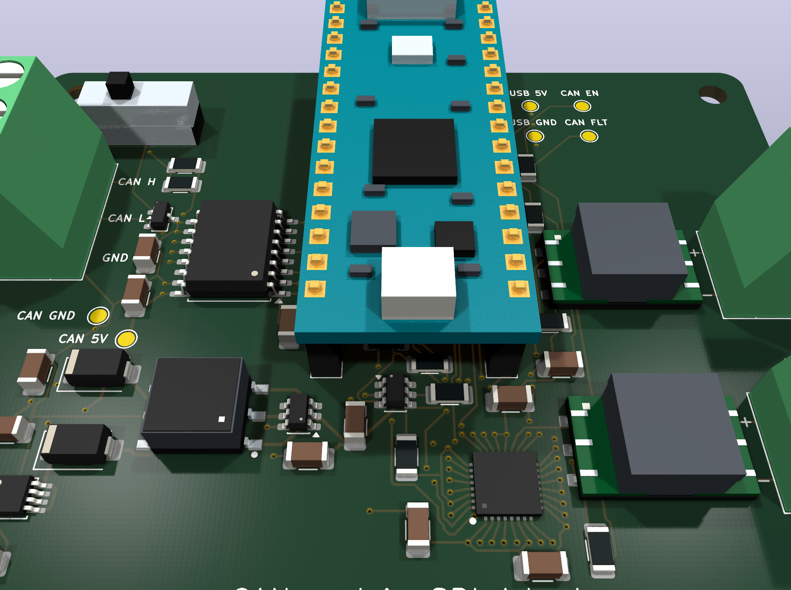
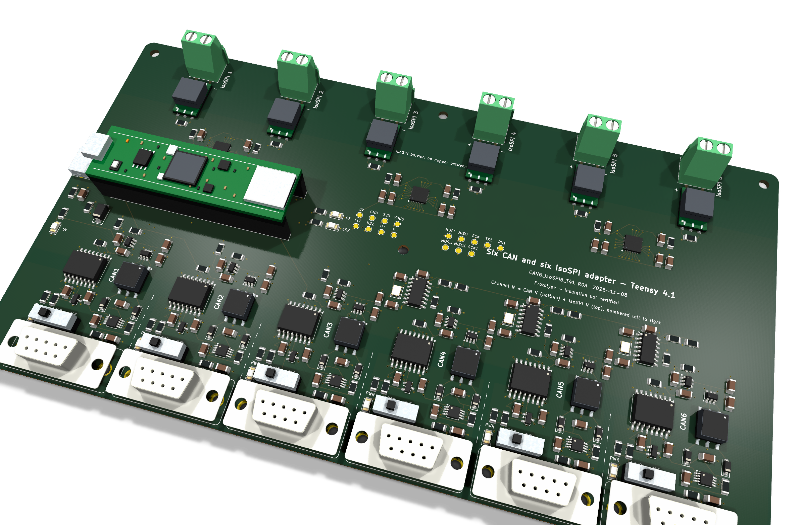

# CAN and isoSPI Adapters

Two open-hardware USB adapters for battery-management bench work. Both connect isolated Classical CAN and isoSPI links to a host PC over USB. The isoSPI ports drive ADBMS1818 / ADBMS6832-class battery-monitor chains through ADBMS6822 dual isoSPI bridges.

| | [Nano R4 adapter](#nano-r4-adapter-r0c) | [Teensy 4.1 adapter](#teensy-41-adapter-r0a) |
|---|---|---|
| Controller | Arduino Nano R4 (socketed) | Teensy 4.1 (socketed) |
| USB | Nano's own USB-C | Carrier USB-C for power and data |
| CAN ports | 1, screw terminal | 6, vertical DSUB-9 female (CiA 303-1 pinout) |
| CAN isolation | ISO1042 with isolated 5 V supply | Six independent ISO1042 channels, each with its own isolated 5 V supply |
| CAN termination | 120 Ω slide switch | 120 Ω slide switch on every port |
| isoSPI ports | 2 (MAIN, AUX) | 6 |
| Board | 82 × 64 mm, 4 layers | 216 × 120 mm, 6 layers |
| Passives | 1206 | 1206 |

> **Bench prototypes.** Both designs pass KiCad 10.0.6 ERC, DRC and schematic-parity checks with the project rules. Hardware bring-up, signal integrity and system insulation qualification have not been done.

## Nano R4 adapter (R0C)

| Interface | Hardware |
|---|---|
| Controller | Arduino Nano R4 with headers (ABX00143), installed in J1/J2 |
| CAN | ISO1042DWR, up to 1 Mbit/s, isolated regulated supply, TVS and switchable 120 Ω |
| isoSPI | ADBMS6822 with MAIN and AUX on separate floating twisted pairs |
| isoSPI magnetics | Two Bourns SM91801AL-E transformers, each specified for 1,000 V DC working voltage and basic insulation |

Orient the board with USB-C at the top. The left terminal is marked **CAN H**, **CAN L** and **GND** from top to bottom. This GND is the isolated CAN reference. Set the slide switch to **120R** when the adapter terminates an end of the bus. The two right terminals are **MAIN** and **AUX**, each a floating differential pair with **+** above **−**.

| Nano pins | Function |
|---|---|
| D4 / D5 | CAN TX / RX |
| D8 / A3 | CAN supply enable, active high / fault, active low |
| D13 / D11 / D12 | SPI clock / controller out / controller in |
| D10 / D9 | MAIN / AUX chip select |
| D2 / D3 | MAIN / AUX interrupt status |
| D6 / D7 | MAIN / AUX wake status |

R0C differs from R0B in one connection: the SN6505B CLK pin is now tied to ground instead of floating, and R10 uses a better-stocked 82 kΩ part. See the [R0C notes](docs/r0c.md).

- [KiCad project](hardware/kicad/CAN_isoSPI_adapter.kicad_pro), [schematic](hardware/kicad/CAN_isoSPI_adapter.kicad_sch) and [routed PCB](hardware/kicad/CAN_isoSPI_adapter.kicad_pcb)
- [Nano R4 firmware](firmware/README.md#nano-r4-adapter)
- [R0C fabrication files](manufacturing/prototype/R0C/README.md) and [checks](tests/R0C/)

## Teensy 4.1 adapter (R0A)

[Top view](docs/images/board-t41-r0a-top.png)

Six isolated CAN ports on DSUB-9 connectors along one long edge and six isoSPI terminals along the opposite long edge. **Channel N** is one column: CAN N sits directly opposite isoSPI N, numbered 1–6 from left to right, and the same number is used on the silkscreen, in the schematic, in reference designators and in the firmware. Each adapter reports a unique ID and an optional stored label, so several can share one host. A single USB-C connector supplies power and USB data; the data lines reach the Teensy through two pogo pins that touch its USB device pads.

| Interface | Hardware |
|---|---|
| Controller | Teensy 4.1 with pins, in two 1 × 24 sockets |
| CAN1–CAN3 | Teensy FlexCAN1–3 (CAN3 is CAN FD capable) |
| CAN4–CAN6 | MCP2518FD controllers on SPI1, 40 MHz crystals |
| Each CAN port | ISO1042DWR, TPS2553 current-limited switch, SN6505B + 760390014 isolated supply, TLV76750 LDO, PESD2CANFD24V TVS, 120 Ω switch, power LED |
| CAN connector | DSUB-9 female: pin 2 CAN_L, pin 7 CAN_H, pins 3 and 6 CAN_GND, pin 5 and shell to a 1 MΩ ∥ 4.7 nF shield network |
| isoSPI | Three ADBMS6822, six SM91801AL-E transformers, six two-pole terminals |
| USB-C | 5.1 kΩ CC pull-downs read by the Teensy for power budgeting, USBLC6 ESD, 2 A PTC, SMAJ5.0A |

- [User manual](docs/user-manual-t41.md) — assembly, flashing, commands and usage examples
- [Hardware notes and pin map](hardware/teensy41/README.md)
- [KiCad project](hardware/teensy41/CAN6_isoSPI6_T41.kicad_pro), generated from [design.py](hardware/teensy41/tools/design.py)
- [Teensy firmware](firmware/README.md#teensy-41-adapter)
- [R0A fabrication files for JLCPCB](manufacturing/prototype/T41-R0A/README.md) and [checks](tests/T41-R0A/)

## Shared documentation

- [Design rationale](docs/hardware-plan.md), [decisions](docs/decisions.md), [component sourcing](docs/components.md) and [references](docs/references.md)
- [Bench verification plan](tests/verification-plan.md)
- [3D model sources](hardware/kicad/models/README.md) and [third-party materials](THIRD_PARTY.md)

## Prototype limits

Each isoSPI cable domain keeps an **8 mm copper clearance** to all other copper. The 1 kV DC figure is the transformer working rating. Board creepage, insulation coordination, cable and enclosure clearances still need validation. The CAN isolation is meant for low-voltage CAN networks.

JLCPCB listed **one** SM91801AL-E (C26423704) on 2026-11-08. The Nano R4 adapter needs two per board and the Teensy adapter needs six. Arrange a pre-order or consigned supply before ordering assembly. Review rotations in the JLCPCB placement preview, socket fit and the remaining open items in [decisions](docs/decisions.md).

No license has been selected yet; see [publication notes](docs/publication.md).
