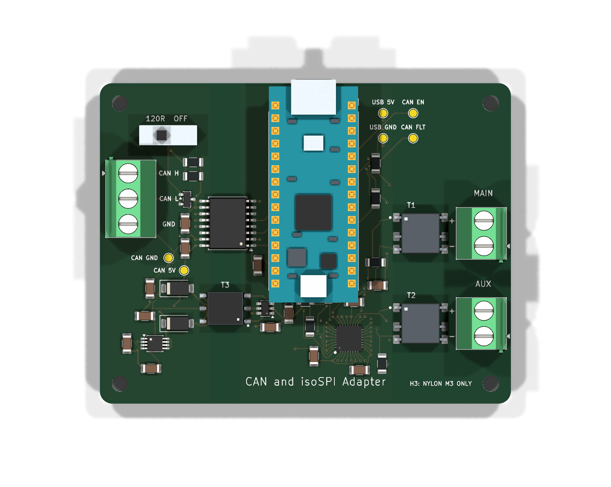

# R0E notes (Nano R4 adapter)

R0E keeps the R0D schematic, outline and most of its copper. On 2026-11-24, JLCPCB no longer stocked three R0D parts, so R0E replaces them with stocked parts. The reasons for each part choice and the full stock list are in [components](components.md#changes-for-stock-r0e-t41-r0c).

## Changes

| Ref | R0D | R0E | Copper change |
|---|---|---|---|
| T1, T2 | Bourns SM91801AL-E | CND-tek HM1238NLTP ([C49230397](https://jlcpcb.com/partdetail/C49230397)) | New land pattern; both parts move 1.825 mm right, to x = 118.975 mm |
| T3 | Würth 760390014 | Maxinmicro MXPP6-3K6110 ([C19943838](https://jlcpcb.com/partdetail/C19943838)) | None: same pinout and land pattern |
| U5 | TI TLV76750DGNR | TI TPS7A1650QDGNRQ1 ([C2832237](https://jlcpcb.com/partdetail/C2832237)) | None: same HVSSOP-8 land pattern |

- **T1/T2.** The HM1238NLTP pad columns are 9.65 mm apart instead of 12.7 mm. Moving each transformer right by 1.825 mm puts the cable-side pads on the existing tracks to J4/J5. The chip-side pads are joined to the old route ends by short 0.2 mm F.Cu stubs.
- **Rerouted runs.** CS_MAIN, USB_5V and one AUX_IP run went straight down F.Cu between the old pad columns. They now run on B.Cu, through five new 0.6/0.3 mm vias, so the new stubs do not cross them. The new copper stays on the chip side of the isoSPI barrier.
- **U5 pins.** On the fixed 5 V TPS7A16, pin 2 (FB/NC) and pin 6 have no internal connection, so pin 2 stays on CAN_5V and pin 6 on GND. PG (pin 3) and DELAY (pin 7) stay open. The schematic symbol shows the new pin names.
- **Title block.** Revision R0E, 2026-11-24.

The layout change was applied to the R0D board with [rework_r0e.py](../hardware/kicad/tools/rework_r0e.py).

## Checks

KiCad 10.0.8 reports zero ERC findings and zero DRC, unconnected-item and schematic-parity findings at all severities, including the 8 mm isoSPI clearance rules ([reports](../tests/R0E/)). The new Gerbers were compared layer by layer with R0D. Edge.Cuts, B.Mask and the NPTH drill file are identical, and the PTH drill file differs only by the five new vias. In the BOM and CPL only T1, T2, T3 and U5 changed. In the CPL only T1 and T2 moved (X 62.15 → 63.975 mm).

## Still open

- **CAN supply headroom.** The MXPP6-3K6110 is 1:1.1 where the 760390014 was 1:1.3. The TPS7A16 runs near dropout, and the ISO1042 bus side gets an estimated 4.7–4.9 V at full dominant load (minimum 4.5 V). Measure CAN 5V at TP3 against TP4 with the bus dominant at the lowest USB voltage you expect. The fallback is the 1:1.3 MXPP6-3K6130 once its pinout is confirmed.
- **HM1238NLTP pin 1.** The datasheet drawing has no pin-1 mark. The part is symmetric and its 3.81/2.54 mm lead pitch lets it fit only one way round, but check the outline in JLCPCB's placement preview.
- Open items carried over from [R0D](r0d.md#still-open): ADBMS6822 decoupling and insulation class.
