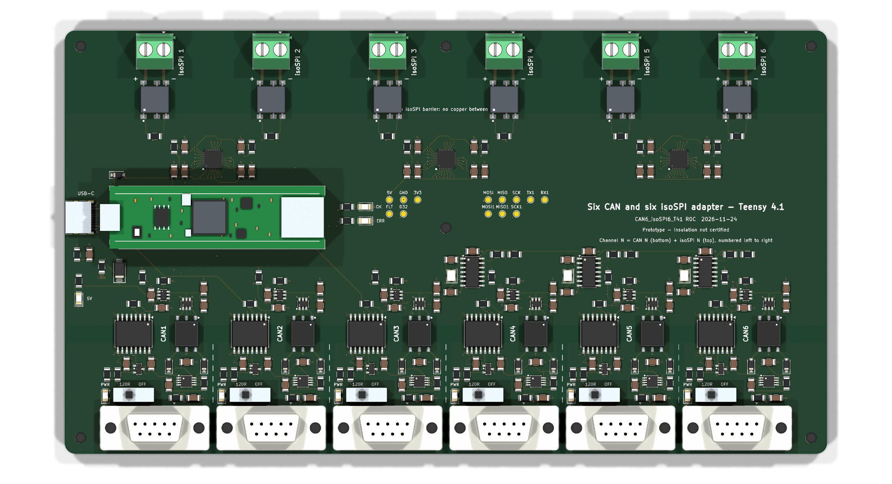

# T41-R0C notes (Teensy 4.1 adapter)

T41-R0C keeps the R0B schematic, placement and routing except for the transformers. On 2026-11-24, JLCPCB no longer stocked three R0B parts, so R0C replaces them with stocked parts. The reasons for each part choice and the full stock list are in [components](components.md#changes-for-stock-r0e-t41-r0c).

## Changes

| Refs | R0B | R0C | Copper change |
|---|---|---|---|
| T701–T902 (isoSPI) | Bourns SM91801AL-E | CND-tek HM1238NLTP ([C49230397](https://jlcpcb.com/partdetail/C49230397)) | New land pattern; parts move to y = 19.6 mm |
| T101–T601 (CAN supply) | Würth 760390014 | Maxinmicro MXPP6-3K6110 ([C19943838](https://jlcpcb.com/partdetail/C19943838)) | None: same pinout and land pattern |
| U104–U604 (CAN 5 V LDO) | TI TLV76750DGNR | TI TPS7A1650QDGNRQ1 ([C2832237](https://jlcpcb.com/partdetail/C2832237)) | None: same HVSSOP-8 land pattern |

- **isoSPI transformers.** The HM1238NLTP pad columns are 9.65 mm apart and the rows have an uneven 3.81/2.54 mm pitch. Each transformer moves to y = 19.6 mm (`ISO_T_Y` in [design.py](../hardware/teensy41/tools/design.py)). There both pad rows clear the 16.5–23.5 mm isoSPI band, and the cable-side pads keep 8 mm to the logic planes that start at 23.5 mm. The cable-side tracks to the terminals are redrawn as two 0.8 mm segments per line. One short 0.2 mm F.Cu stub joins each chip-side pad to the existing R0B route.
- **LDO pins.** On the fixed 5 V TPS7A16, pin 2 (FB/NC) and pin 6 have no internal connection, so pin 2 stays on CANxI_5V and pin 6 on CANxI_GND. PG (pin 3) and DELAY (pin 7) stay open.
- **Revision text and title block.** R0C, 2026-11-24.

`design.py` carries the new parts and transformer position, and `generate_t41.py sch` reproduces the committed schematic. The layout change was applied to the routed R0B board with [rework_r0c.py](../hardware/teensy41/tools/rework_r0c.py).

## Checks

KiCad 10.0.8 reports zero ERC findings and zero DRC, unconnected-item and schematic-parity findings at all severities, including the 8 mm isoSPI clearance rules ([reports](../tests/T41-R0C/)). The new Gerbers were compared layer by layer with R0B. Edge.Cuts, B.Mask and both drill files are identical. In the BOM, only the three part groups above changed. In the CPL, only T701–T902 moved (Y 100.0 → 100.4 mm).

## Still open

- **CAN supply headroom.** The MXPP6-3K6110 is 1:1.1 where the 760390014 was 1:1.3. The TPS7A16 runs near dropout, and the ISO1042 bus side gets an estimated 4.7–4.9 V at full dominant load (minimum 4.5 V). Measure each port's isolated 5 V with the bus dominant at the lowest USB voltage you expect. The fallback is the 1:1.3 MXPP6-3K6130 once its pinout is confirmed.
- **HM1238NLTP pin 1.** The datasheet drawing has no pin-1 mark. The part is symmetric and fits only one way round, but check the outline in JLCPCB's placement preview.
- **Stock for larger orders.** EG1218 (139) and ISO1042DWR (206) limit an order to about 23 boards. ISO1042BDWR (C2671499) is a drop-in second source.
- Open items carried over from [T41-R0B](t41-r0b.md#still-open): ADBMS6822 decoupling, pogo-pin reflow, insulation class, hot-plug capacitance and net classes.
