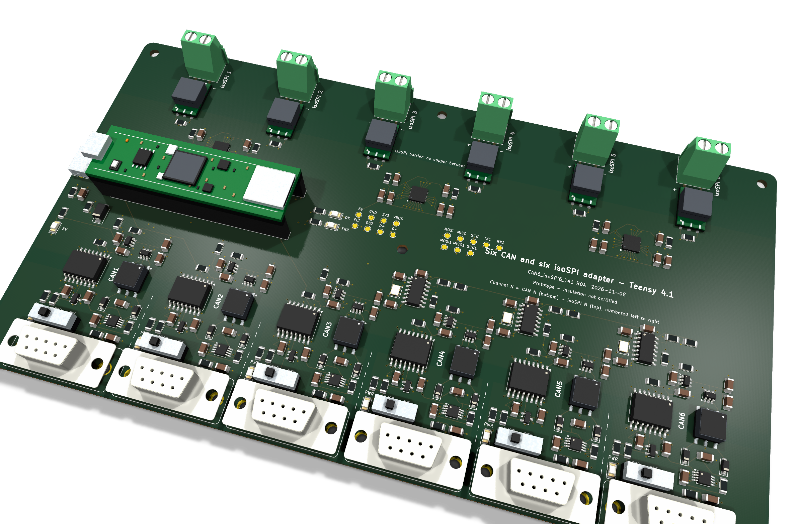

# Teensy 4.1 adapter — six CAN, six isoSPI (R0A)

Open [CAN6_isoSPI6_T41.kicad_pro](CAN6_isoSPI6_T41.kicad_pro) in **KiCad 10.0.6**. The schematic, PCB placement, zones, design rules and manufacturing CSVs are generated from [tools/design.py](tools/design.py) by [tools/generate_t41.py](tools/generate_t41.py). Edit `design.py` and regenerate rather than editing the schematic and board separately.



## Board

- **216 × 120 mm**, six layers, 1.6 mm, six M3 holes, all passives 1206.
- **Bottom edge:** six vertical DSUB-9 female connectors (mating face up, 4-40 standoffs), CAN1 on the left. Each has its own 120 Ω slide switch (**120R** / **OFF**) and a green LED that lights when its isolated supply is on.
- **Top edge:** six isoSPI terminals, each directly opposite the CAN port with the same number; **+** is on the left of each pair.
- **Left edge:** USB-C for power and data. The Teensy plugs into J2/J3 with its USB end toward the USB-C connector.

| Layer | Use |
|---|---|
| F.Cu | Components, signals and ground fanouts |
| In1.Cu | Logic ground plane; a separate ground plane for each isolated CAN port |
| In2.Cu | Signals |
| In3.Cu | Signals and a +5 V pour |
| In4.Cu | Second logic ground plane and per-port isolated ground planes |
| B.Cu | Signals, logic ground pour and per-port isolated ground pours |

The isoSPI cable side of each transformer has no plane under it and keeps 8 mm of copper clearance to everything else. Each CAN port's isolated domain is kept 3 mm away from logic copper and from its neighbours. Both rules are in [CAN6_isoSPI6_T41.kicad_dru](CAN6_isoSPI6_T41.kicad_dru).

## Channel addressing

Channel **N** is one column of the board: DSUB-9 **CAN N** on the bottom edge and terminal **isoSPI N** directly above it on the top edge. Channels are numbered 1–6 from left to right, viewed from the component side with USB-C on the left. The same number is used on the silkscreen, in the schematic net names (`CANn_*`, `ISOn_*`), the reference designators (CAN parts are numbered n01–n12, so channel 4 uses U401, J401, SW401…) and the firmware commands.

| Channel | CAN controller | isoSPI bridge | Bridge channel |
|---|---|---|---|
| 1 | FlexCAN1 | U701 | 2 |
| 2 | FlexCAN2 | U701 | 1 |
| 3 | FlexCAN3 (CAN FD capable) | U801 | 2 |
| 4 | MCP2518FD U405 | U801 | 1 |
| 5 | MCP2518FD U505 | U901 | 2 |
| 6 | MCP2518FD U605 | U901 | 1 |

isoSPI transformers and terminals use T7xx/J7xx for channels 1–2, T8xx/J8xx for 3–4 and T9xx/J9xx for 5–6. Each adapter reports a factory-unique ID over USB, and a user label can be stored in EEPROM, so several adapters on one host can be addressed reliably. See the [firmware commands](../../firmware/README.md#usb-serial-commands-1).

## Test points

Sixteen 1.5 mm test pads are placed in two groups between the Teensy and the right mounting hole. Probe them with an oscilloscope or multimeter during bring-up.

| Label | Net | Group | Row |
|---|---|---|---|
| 5V | +5V | Left | 1 |
| GND | GND | Left | 1 |
| 3V3 | +3.3V | Left | 1 |
| VBUS | USB VBUS | Left | 1 |
| FLT | CAN_PWR_FAULT | Left | 2 |
| D32 | Teensy pin 32 (spare) | Left | 2 |
| D+ | USB_DP | Left | 2 |
| D- | USB_DM | Left | 2 |
| MOSI | ISO_MOSI (isoSPI SPI) | Right | 1 |
| MISO | ISO_MISO | Right | 1 |
| SCK | ISO_SCK | Right | 1 |
| TX1 | CAN1_TX (FlexCAN1) | Right | 1 |
| RX1 | CAN1_RX | Right | 1 |
| MOSI1 | MCP_MOSI (SPI1) | Right | 2 |
| MISO1 | MCP_MISO | Right | 2 |
| SCK1 | MCP_SCK | Right | 2 |

## 3D view

Every fitted part has a model. Standard parts use the KiCad 10 library; the ADBMS6822, transformers, slide switch, pogo pins, USB-C receptacle and a mounted Teensy 4.1 use drawing-based VRML models from [../kicad/models](../kicad/models/README.md). Open **View → 3D Viewer** or run `kicad-cli pcb render --quality high`.

## Before first power-up

1. **Cut the VIN–VUSB pads** on the Teensy's underside. The carrier feeds VIN through F1 (2 A PTC) and D2 (Schottky). Leaving the pads joined connects carrier VBUS to the Teensy micro-USB VBUS pin.
2. Use the carrier USB-C only. J4 and J5 are pogo pins that press on the Teensy's USB device D−/D+ pads, so the Teensy enumerates and is programmed through the carrier connector. Do not plug the Teensy's micro-USB at the same time.
3. Measure the D−/D+ pad positions on your Teensy against J4/J5 before assembly; see [open items](../../docs/decisions.md#teensy-41-adapter-decisions-r0a-2026-11-08).

## CAN port wiring

| DSUB-9 pin | Signal |
|---|---|
| 2 | CAN_L |
| 7 | CAN_H |
| 3, 6 | Isolated CAN ground of that port |
| 5, shell | Shield, to that port's ground through 1 MΩ ∥ 4.7 nF 2 kV |
| 1, 4, 8, 9 | Not connected |

This is the CiA 303-1 layout used by PEAK PCAN adapters, so standard CAN cables and termination plugs fit.

## Teensy 4.1 pin map

| Teensy pin | Function | Teensy pin | Function |
|---|---|---|---|
| 22 / 23 | CAN1 TX / RX (FlexCAN1) | 17, 18, 19, 20, 21, 24 | CAN1–CAN6 supply enable, active high |
| 1 / 0 | CAN2 TX / RX (FlexCAN2) | 25 | CAN supply fault, wired-OR, active low |
| 31 / 30 | CAN3 TX / RX (FlexCAN3, FD capable) | 26 / 39 / 27 | SPI1 MOSI / MISO / SCK to MCP2518FD |
| 11 / 12 / 13 | SPI MOSI / MISO / SCK to ADBMS6822 | 38, 37, 36 | CAN4, CAN5, CAN6 MCP2518FD chip select |
| 10, 9, 8, 7, 6, 5 | isoSPI port 1–6 chip select | 35, 34, 33 | CAN4, CAN5, CAN6 MCP2518FD interrupt |
| 2, 3, 4, 14, 15, 16 | isoSPI port 1–6 INTR | 40 / 41 | USB-C CC1 / CC2 sense through 1 kΩ |
| 28 / 29 | Green OK LED / red fault LED | 32 | Spare, test pad TP5 |

Logic runs at 3.3 V from the Teensy's regulator. ADBMS6822 VDDS and MSTR use 3.3 V; VDD and VP use 5 V. ISO1042 VCC1 is 3.3 V and VCC2 is the port's isolated 5 V.

## Power

USB-C VBUS → F1 → SMAJ5.0A → +5 V plane. Each CAN port has a TPS2553 switch limited to about 200 mA (R_ILIM = 130 kΩ) feeding an SN6505B push-pull driver, a Würth 760390014 1:1.3 transformer, two B5819W rectifiers and a TLV76750 5 V LDO. The switches stay off until firmware opens a port. Provisional worst case is about 110 mA from 5 V per transmitting CAN port plus about 250 mA for the Teensy, bridges and controllers, so all six ports need a 1.5 A or 3 A USB-C source. The firmware reads the source's CC advertisement and limits a default USB port to two open CAN ports.

## Regenerating

```sh
PY=/Applications/KiCad/KiCad.app/Contents/Frameworks/Python.framework/Versions/Current/bin/python3
export JAVA=/path/to/java FREEROUTING_JAR=/path/to/freerouting.jar
$PY hardware/teensy41/tools/generate_t41.py pcb      # schematic, project, rules, placement, ground and QFN fan-out
$PY hardware/teensy41/tools/generate_t41.py route    # Freerouting 2.x through a Specctra round trip
$PY hardware/teensy41/tools/generate_t41.py patch    # pours, zone fill, close leftovers, trim dangling copper
$PY hardware/teensy41/tools/generate_t41.py fab manufacturing/prototype/T41-R0A
```

How the generator gets a clean route:

- Every ground pad is fanned out to its plane before routing, and each ADBMS6822 pin gets a fixed escape to a via ring around the QFN, because an autorouter cannot reliably escape a 0.5 mm-pitch QFN with neighbouring decoupling.
- For routing, each ground pad and its fan-out get a private net, and the two ground-plane layers are removed from the Specctra file. The router therefore only uses F.Cu, In2, In3 and B.Cu, and leaves the planes intact.
- The isoSPI band and the CAN isolation gaps are temporary keepouts during routing; the final board checks them with the DRC rules instead.

Routing is not deterministic, so a regenerated board needs a new DRC run and a new manufacturing package. The `pcb` stage overwrites the routed board. The committed board reports zero ERC, DRC, unconnected-item and schematic-parity findings at all severities ([reports](../../tests/T41-R0A/)).
